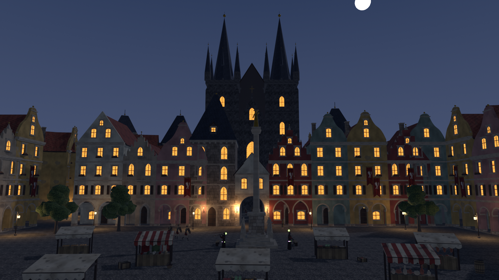
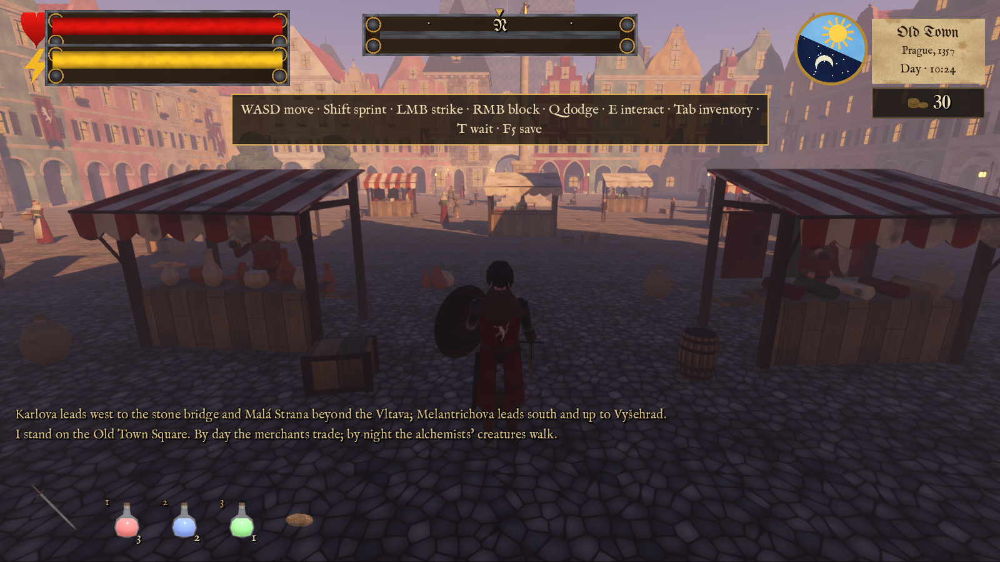
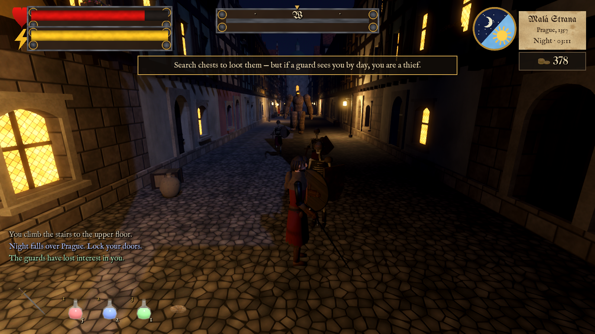

# Alchemists of Prague — assets and game (Old Town Square, Charles Bridge, Malá Strana, Vyšehrad)

An action RPG set in medieval Prague (in the spirit of Gothic 1–2), built with Godot 4.7. Tasks 1–5 were completed twice:
first as a vertical slice (Old Town Square), then (run 2) Charles Bridge, Malá Strana and Vyšehrad. After that all four
parts were merged into **one open world** (`build_prague.py`).



| | |
|---|---|
|  |  |

**One world**: all four parts of Prague are connected by streets and the bridge, with no loading screens. The Vltava
separates Malá Strana; the city is bounded by the river, walls and locked gates. The district name is shown on a HUD
plaque, the map is under Tab → Map.

| From | Which way | Where you end up |
|---|---|---|
| Old Town Square | west along **Karlova** street | the Old Town Bridge Tower and **Charles Bridge** |
| Charles Bridge | across the whole bridge and through the Malá Strana tower | **Malá Strana** (Mostecká → square → stairs up to the Castle) |
| Old Town Square | south along **Melantrichova**, then up the road between the walls | the gates of **Vyšehrad** |

What's new:
- one world of four districts: walk between them, no loading; the world is bounded by the river, walls and locked gates;
- the Vltava; throw enemies off the bridge into the river, off the Vyšehrad walls into the abyss and off the Malá Strana terrace;
- a tavern where you can sleep, knights at the tiltyard, monks, boatmen;
- reworked Václav: face, hood, surcoat, shield, sword; jump, dodge, double strike; a new Czech lion on the coats of arms;
- bug fix: the inventory could not be closed (now Tab / I / Esc / Close).

Everything is generated by Python scripts in Blender 5.2: models, textures, rigs, animations, level layout.
Any file can be rebuilt with a single command (see "Rebuilding").

## Play (Task 5)

**▶ In the browser (PC or phone): https://severance.lol/4/** · **Android APK: https://severance.lol/4/AlchemistsOfPrague.apk**

**⬇ Download (Windows .exe and Android .apk): https://github.com/msveshnikov/alchemists-of-prague/releases/latest**

- Build: `build/windows/AlchemistsOfPrague.exe` (Windows, self-contained).
- From source: open this folder in Godot 4.7.2 and press F5.

| Key | Action |
|---|---|
| W A S D | move |
| Shift | sprint |
| Caps Lock | walk / run |
| Space | jump |
| Q / Alt | dodge |
| Left mouse button | strike (click again for a combo) |
| Right mouse button | block with the shield |
| E / F | enter a house · trade · blacksmith · chest · tavern and sleeping · talk · **grab a staggering enemy** · **throw them out of a window / off the bridge / off the wall** |
| 1 / 2 / 3 | healing / stamina / antidote |
| Tab / I | inventory (Character, Journal, Map); close with Tab, I, Esc or the Close button |
| T | wait until dusk or dawn |
| F5 / F9 | quick save / quick load |
| Esc | pause |

**Touch controls** turn on automatically on phones (APK and mobile browser) and after the first touch on the screen:
left finger is a floating stick (drag past the outer ring to sprint), right finger looks around;
buttons "Strike" (dragging from it also looks around), "Block" (hold), "Dodge", "Jump", "Use" (blinks when there is
something to interact with); top right are "Wait", "Bag" (inventory) and "Menu" (pause: saving and settings).
To drink a potion, tap its slot on the HUD.
Code: `scripts/ui/touch_controls.gd`. On a PC you can test it with the `-- --touch` argument.

Export: the `Windows Desktop`, `Web` and `Android` presets in `export_presets.cfg` (Web and Android use the
Compatibility renderer, S3TC+ETC2 textures, the APK is signed with a debug key, arm64). Only `assets/levels/prague_*.json`
go into the build.
```
godot --headless --path . --export-release "Windows Desktop" build/windows/AlchemistsOfPrague.exe
godot --headless --path . --export-release "Web" build/web/index.html
godot --headless --path . --export-debug "Android" build/android/AlchemistsOfPrague.apk
scp build/web/* build/android/AlchemistsOfPrague.apk ubuntu@severance.lol:/var/www/severance/4/
gh release create vX.Y build/windows/AlchemistsOfPrague.exe build/android/AlchemistsOfPrague.apk --title "..." --notes "..."
```
GitHub releases (exe + APK downloads): https://github.com/msveshnikov/alchemists-of-prague/releases —
bump `version/code` and `version/name` of the Android preset for every new release.

Tip: an alchemist is hiding in the first house on the square — wound him, grab him (E) and throw him out of the window (E).
On Charles Bridge a weakened enemy can be thrown over the parapet into the Vltava, at Vyšehrad off the wall into the abyss.
In the Malá Strana tavern you can sleep and heal for 10 groschen.
Autotest: `godot --path . -- --autotest` → `renders/game/` (70 checks: the square, keyboard inventory, combat, houses,
defenestration, trading, night, saving, and then on foot across the whole world: Karlova → bridge → Malá Strana, the road
to Vyšehrad, throws off the bridge and walls, the tavern, the stairs, night in every district).
Performance probe: `godot --path . scenes/game.tscn -- --perf`; a single district on its own (debugging): `-- --layout old_town`.
Screenshots at given points: `-- --tour x,z,yaw[,pitch[,y]] cam,px,py,pz,tx,ty,tz ...` (`--tour-night` for night) → `renders/game/tour_N.png`.

**World bounds.** The player cannot walk out of the four districts into the empty field: alleys between houses and street
ends are closed off with stone walls (narrow ones with boarded-up wooden gates), and the districts are separated by the
Vltava. The walls are not placed by hand; `tools/seal_world.py` finds them: the `--reach` probe uses physics to build a
grid of reachable cells, everything near content (doors, lanterns, stalls, townsfolk, patrol routes) counts as town,
everything farther than 22 m counts as field, and a minimum cut between them yields the narrowest passages. The result is
`assets/levels/prague_seal.json` (47 walls ≈ 200 m, plus 222 paving tiles beyond the walls that the game does not place,
so a meadow shows there). It also contains the "field" mask (`field`): cells beyond the wall line that the hero cannot
reach through any gap (`world.keep_in_town`, acts as an invisible wall). The probe can run with a 0.5 m step
(`--reach-step 0.5`): it then finds gaps as narrow as a metre. After rebuilding the world in Blender:
```
godot --headless --path . scenes/game.tscn -- --reach --no-seal    # open world → renders/world/reach_open.*
python tools/seal_world.py                                          # → assets/levels/prague_seal.json (+ seal_preview.png)
godot --headless --path . scenes/game.tscn -- --reach --reach-jump  # check the sealed world, with jumping
python tools/seal_world.py --check                                  # "leaked into the field 0" = no way out
```

**The river** (`scripts/river.gd`): ~20 boats and barges are moored along both embankments, and 12 vessels travel up and
down the river through the middle arches of the bridge — punts, cargo barges and large sailing barges with a striped sail
(the mast is lowered when passing under the bridge). A boatman with a pole stands at the stern; barges carry a lantern at night.

**Performance**: townsfolk and enemies spawn within ~105 m of the player, small objects and lanterns are hidden at a distance.
On integrated graphics (Intel UHD 620) it runs at 6–10 fps, same as the former standalone Old Town;
on a discrete GPU and in the browser with Compatibility it is noticeably faster.

## Make games the same way: the `game-pipeline` plugin for Claude Code

The whole pipeline of this game is packaged as the `game-pipeline` skill, which lives in a separate repository,
[msveshnikov/claude-game-pipeline](https://github.com/msveshnikov/claude-game-pipeline):
concept docs and prompts, concept art via ChatGPT in the Claude desktop built-in browser, task1–task5 templates,
Blender conventions (everything through Python), Godot architecture (level from JSON, UI in code, autotest), builds and deployment.
Installing in Claude Code:

```
/plugin marketplace add msveshnikov/claude-game-pipeline
/plugin install game-pipeline@claude-game-pipeline
```

The old commands with `alchemists-of-prague` still work: this repository's marketplace points to the new one.
Without plugins you can copy the `skills/game-pipeline` folder from that repository into `~/.claude/skills/`.
After that, just tell Claude "let's make a game …" or "do task3", and the skill kicks in on its own.

## Layout

```
prague/
├─ README.md                      ← this file
├─ project.godot, export_presets.cfg   Godot 4.7 project and export presets
├─ icon.svg                       game icon (a flask with Týn Church at sunset); raster versions in assets/ui/app_icon/
├─ scenes/                         main_menu.tscn, game.tscn
├─ scripts/                        game GDScript (game, sfx, world, river, day_night, player, enemy, npc, potion, autotest, perf_probe, reach_probe, shot_tour, ui/)
├─ build/windows|web|android/      builds (.gdignore)
├─ task1.md … task5.md            tasks (the "Old Town Square" slice + the "Run 2" section)
├─ report_task1.md … report_task5.md   task reports
├─ decisions.md                   all decisions and conventions (axes, node names, markers)
├─ issues.md                      known issues and workarounds
├─ props_list.md                  environment and props list (Task 1)
├─ characters_list.md             characters: height, animations, speeds (Task 2)
│
├─ concept/                       concept art: locations/, characters/, ui/  (.gdignore)
├─ concept_art/                   source images (.gdignore)
│
├─ assets/                        ← EVERYTHING the game needs (imported into Godot)
│  ├─ architecture/*.gltf|.bin    40 buildings and city pieces: town hall, Týn, burgher and half-timbered houses, tavern,
│  │                              bridge towers, bridge span, embankment, stairs, Vyšehrad walls and towers,
│  │                              rotunda, basilica, cliffs, the climb to Vyšehrad, tiles, backdrops (Castle, city)
│  ├─ props/*.gltf|.bin           46 props: stalls, spit, forge, carts, boats, statues, targets, gravestones…
│  ├─ characters/*.gltf|.bin      15 characters with skeletons and animations (+ knight, monk, boatman)
│  ├─ textures/*.png              shared textures for all glTF files (albedo + *_n normals)
│  ├─ audio/ fonts/ ui/            sounds and music, fonts, UI textures and icons (Task 5)
│  │  └─ ui/app_icon/             app icon: .ico (Windows), 192 + adaptive 432 layers (Android), 144/180/512 (PWA)
│  ├─ levels/
│  │  ├─ prague_layout.json       THE WHOLE WORLD: 1303 instances, markers, districts, water, bounds, lighting, map
│  │  ├─ prague_population.json   193 characters across all districts: schedule, roles, routes, effects
│  │  └─ old_town_*, charles_bridge_*, mala_strana_*, vysehrad_*   individual districts (sources for the world build)
│  ├─ shaders/water.gdshader      Vltava water
│  └─ CREDITS.md                  external assets (none yet — everything is original)
│
├─ blender/                       sources (.gdignore — Godot does not import them)
│  ├─ scripts/                    generators (see below)
│  ├─ textures/                   generated textures (source for assets/textures)
│  ├─ architecture.blend          building library (one collection per asset)
│  ├─ props.blend                 props library
│  ├─ characters.blend            rigged characters (animations as NLA tracks)
│  ├─ world_old_town.blend        empty level (Task 3): collection instances, markers, day/night cycle
│  ├─ scene_old_town.blend        living scene (Task 4): level + population + effects
│  ├─ locations.blend             run 2 assets (bridge, Malá Strana, Vyšehrad, backdrops)
│  ├─ world_<L>.blend, scene_<L>.blend   individual districts (L = charles_bridge, mala_strana, vysehrad)
│  └─ world_prague.blend, scene_prague.blend   the whole world and its population
│
└─ renders/                       previews (.gdignore)
   ├─ previews/                   every asset and character (+ night versions, + animation contact sheets)
   ├─ world/                      empty levels: day/night, plans, comparison with the art; prague_* — the whole world and seams
   ├─ scene/                      living scenes: day/night, close-ups, comparison with the art
   └─ game/                       autotest screenshots
```

## Conventions (short; details in decisions.md)

- 1 unit = 1 m. Coordinates in the JSON files are already **in Godot space** (+Y up, plan north = −Z).
- Building facades and the "front" of characters face **Godot +Z** (glTF standard). `yaw_deg` is rotation around +Y.
- A marker faces the same way the character standing on it should face.
- Nodes inside glTF files:

| Prefix | What it is |
|---|---|
| `INT_door_*` | door, pivot on the hinge |
| `INT_window_*` (+`_shutter_L/R`) | window for defenestration and hinged shutters |
| `INT_stall_*`, `INT_anvil` | merchant, blacksmith |
| `MARK_*` | points: door/interior/below window/merchant/customer/blacksmith/cook/horse |
| `ANIM_spit`, `ANIM_banner` | spit rotation, banner sway |
| `LIGHT_*` | point light; multiply night light by `lamp_factor` from the presets |
| `*-colonly` | collision (Godot builds a StaticBody3D from it) |
| `<name>_body`, `<name>_rig` | character mesh and skeleton |
| `WEAPON_*`, `HELD_*` | weapons and held items, can be hidden or swapped |

- Materials that glow at night: `M_WindowLit`, `M_LanternGlass` — turn off emission during the day. Fire and embers always glow.
- Character animations: `idle, walk, run, hit, death, flail` + `attack` (enemies, guards), `block, throw, jump, dodge, attack2`
  (Václav), `talk/work/beg/cast` (townsfolk, alchemist), `spar` (knight), `pray` (monk), and `idle, walk, pull` for the horse.
  No root motion; speeds are in characters_list.md.

## Using it in Godot (Task 5)

1. The Godot project root is this folder. Paths in JSON are `res://assets/...`.
2. World: read `assets/levels/prague_layout.json` and for every entry in `instances[]` instantiate
   `path` at `pos` rotated by `yaw_deg` around Y. 1303 instances, glTF scenes are reused; each has a `district` field.
   Extra world fields:

| Field | What it is |
|---|---|
| `districts[]` | districts: `id`, `name`, rectangle `rect` [x0, z0, x1, z1], district offset `offset`, fog density `fog` |
| `water[]` | river planes: height and rectangle (the Vltava at −6 m) |
| `planes[]` | distant ground beyond the blocks (no collision) |
| `blockers[]` | invisible walls: world edge, the locked Castle gates |
| `kill_y` | below this you have fallen into the river / off the edge: the player returns to the bank, an enemy dies |
| `map` | center and size of the `assets/ui/map_prague.png` plan for the "Map" tab |

3. Markers `markers[]` (run 2 district markers get `@<district>` appended to the name, e.g. `MARK_player_start@vysehrad`):

| `kind` | What it is |
|---|---|
| `door` / `interior` / `window` | house entrances and windows for defenestration; the `owner` field is the house |
| `merchant` / `customer` / `smith` / `cook` / `horse` | workplaces |
| `spawn` | enemies (`enemy`, `time: night`) |
| `npc`, `patrol`, `wander` | NPCs, guard patrol route, wander points |
| `player` | player start (the shared start is `MARK_player_start` on Old Town Square) |
| `ledge` | throw point over a parapet / wall; the marker faces where the enemy will fly |
| `gate`, `inn`, `guard_post` | tower gates, the tavern counter, guard post |
| `exit` | closed roads beyond the world edge (`leads_to`: powder_gate, jewish_town, castle) |

4. Population: `assets/levels/prague_population.json → population[]`:
   - `character` and `path` — which scene to instantiate;
   - `animation` — which animation to play;
   - `schedule` — when the character is present: `day`, `night` or `always`;
   - `role` — role, `route`/`route_points` — route, `district` — district, `static` — don't move (boatmen on boats).
   In game, characters appear only near the player (radius ~105 m).
5. Effects: `fx[]` — spit rotation, banner sway, fire flicker, smoke (GPUParticles3D in Godot), banner props.
6. Day/night: `layout.lighting.keys` — sun, sky, lamp and window keys over a 400-frame cycle.
   Recommended cycle length is 1200 s (≈20 minutes, as in Task 5).

## Rebuilding

`blender` = `C:\Program Files\Blender Foundation\Blender 5.2\blender.exe`, run from `blender/scripts`:

```
blender -b --factory-startup -P make_textures.py          # environment textures
blender -b --factory-startup -P make_char_textures.py     # character textures
blender -b --factory-startup -P build_architecture.py     # buildings (+previews)      [-- --no-render | --only a,b]
blender -b --factory-startup -P build_props.py            # props (+previews)
blender -b --factory-startup -P build_characters.py       # characters (+previews)
blender -b --factory-startup -P build_world.py            # level + layout.json (+renders)
blender -b --factory-startup -P build_scene.py            # population + effects + population.json (+renders)
blender -b --factory-startup -P make_ui_assets.py         # UI textures and item icons (Task 5)
# run 2
blender -b --factory-startup -P make_textures_locations.py   # rock, grass, soil, target, sign, gravestone + the new lion
blender -b --factory-startup -P build_locations.py           # bridge, Malá Strana, Vyšehrad assets, backdrops (+previews)
blender -b --factory-startup -P build_world_ext.py -- --level charles_bridge   # level + population + renders + map
blender -b --factory-startup -P build_world_ext.py -- --level mala_strana
blender -b --factory-startup -P build_world_ext.py -- --level vysehrad
blender -b --factory-startup -P build_prague.py              # whole world: prague_layout.json + prague_population.json + map
```

Order matters: textures → architecture/props → characters → districts → the whole world (`build_prague.py` reads
`architecture.blend`, `props.blend`, `locations.blend`, `characters.blend` and the district builders).

Modules:
- `lib_tex.py`, `lib_tex_char.py`, `lib_tex2.py` — textures; `lib_heraldry.py` — the Czech lion;
- `loc_common.py`, `loc_bridge.py`, `loc_mala.py`, `loc_vysehrad.py` — run 2 assets;
- `build_world_ext.py` — run 2 districts; `build_prague.py` — the whole-world build (offsets, seams, bounds);
- `lib_geo.py` — meshes, materials, UVs, glTF export;
- `lib_char.py` — lofts, skeletons, skinning, poses, animations;
- `lib_render.py`, `sheet.py` — previews.
